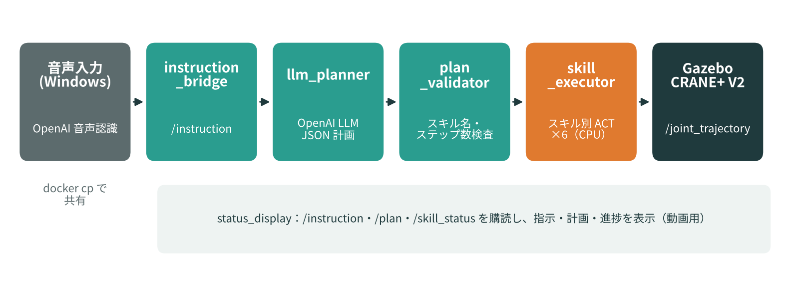
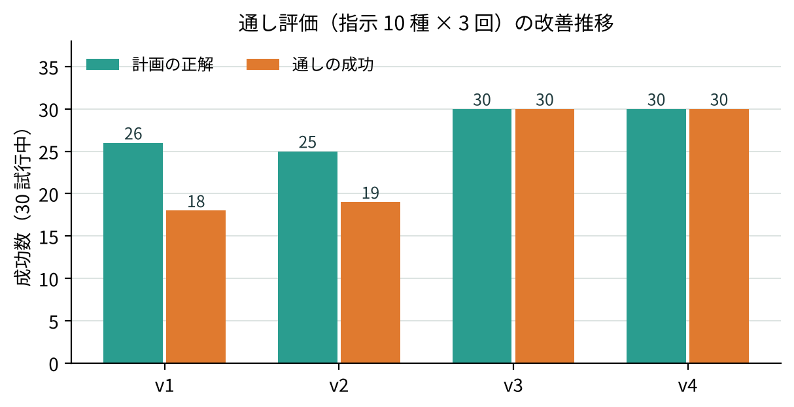

# 声で頼むと手伝う調理補助アーム

Physical AI 応用1講座 最終課題

**音声 × LLM による手順分解 × 模倣学習（ACT）スキルの連続実行** ／ ROS 2 Humble + Ignition Gazebo + CRANE+ V2（GPU なし・CPU のみ）

「カレーを混ぜて、塩を少し振って、できたら出して」と話しかけると、LLM が手順を
`stir → shake → serve → bow` に分解し、スキルごとに学習した ACT 方策で順に実行します。



- 動画：【YouTube URL】
- 説明資料：OmniCampus に PDF で提出

---

## 特徴

| 層 | 担当 | 内容 |
|---|---|---|
| 高レベル（何をするか） | OpenAI LLM + 検証層 | 自由な日本語 → 登録スキルだけの JSON 計画。不正なら 1 回だけ作り直し、実行できない指示は理由付きで拒否 |
| 低レベル（どう動くか） | ACT × 6 スキル | 関節角のみを入力とする ACT をスキルごとに学習（各 15 エピソード、CPU で約 20〜30 分／スキル） |
| 入出力 | 音声入力・表示ウィンドウ | Windows で録音 → OpenAI 音声認識（約 2.3 秒）／指示・計画・進捗を tkinter で表示 |

### スキル

| スキル | キッチンでの意味 | 動き |
|---|---|---|
| `bow` | お待たせしました | 前傾して止まる |
| `point_left` / `point_right` | 調味料はあちら | 根元を旋回し腕を伸ばす |
| `serve` | 皿を差し出す | 前腕を水平に伸ばしグリッパを開く |
| `stir` | 鍋を混ぜる | 円を描きながら少しずつ持ち上げる |
| `shake` | 塩を振る | 手首を振りながら横へ流す |

## 評価結果

指示 10 種（単一 3・複合 4・言い換え 2・拒否 1）× 3 回を自動投入（`nodes/eval_full.py`）。

| 版 | 主な変更 | 計画の正解 | 通しの成功 |
|---|---|---|---|
| v1 | 最初の統合版 | 26/30 | 18/30 |
| v2 | 静止判定の閾値を緩和 | 25/30 | 19/30 |
| v3 | 評価の不具合修正・プロンプトに例を追加・直立復帰後の待機・bow 専用の判定 | 30/30 | 30/30 |
| **v4** | **肩の符号を修正し serve を再設計、6 スキルを再学習** | **30/30** | **30/30** |



## 工夫した点（state-only ACT のための手本設計）

- **開始姿勢と終了姿勢を分ける**：直立で始まり直立で終わると「動き出すのか終わったのか」を区別できない
- **周期動作はドリフトさせる**：stir は持ち上げながら、shake は横へ流しながら。同じ状態を二度通らない
- **動き出しは ease-out**：始点で速度 0 だと直立付近の行動≒0 を学習し、推論時に直立で固まる
- **終了姿勢で 1 秒保持**：チャンク後半（終了後）を学習させ、終了姿勢での揺れを約 11° → 約 0.1° に
- **スキルごとに別の方策**：全スキルが同じ直立から始まるため、スキル選択は LLM 側に任せる

詳細な経緯（発見した 6 つの問題と対策）は説明資料を参照してください。

---

## リポジトリ構成

```
scripts/
  record_demo.py        手本データの収集（6 スキル、--dry-run で見た目確認）
  set_skill.sh          pai_training の変換・学習設定をスキルごとに切替
nodes/
  kitchen_skills.py     スキル定義と計画の検証（plan_validator）
  llm_planner.py        /instruction → OpenAI → /plan（JSON）
  skill_executor.py     /plan のスキル列を ACT で順に実行（pixi 環境で起動）
  status_display.py     指示・計画・進捗の表示ウィンドウ
  instruction_bridge.py /workspace/inbox/*.txt → /instruction
  instruction_cli.py    キーボードで /instruction に送る
  eval_planner.py       計画だけの評価（ロボット不要）
  eval_full.py          通しの評価（10 種 × N 回）
host/
  voice_input.py        Windows で動かす音声入力（録音 → 音声認識 → コンテナへ送信）
docs/                   図
```

学習データ（rosbag・LeRobotDataset）と学習済みモデルは容量のため含めていません。下の手順で再現できます。

## 動かし方

### 前提

- 講義の Docker イメージ `airobotbook/ros2-desktop-ai-robot-book-humble`（作業フォルダを `/workspace` にマウント）
- 講義の [matsuolab/pai_training](https://github.com/matsuolab/pai_training) と [matsuolab/physicalai_teleop](https://github.com/matsuolab/physicalai_teleop) を `~/` にセットアップ済み
- `pai_training/configs` の元の設定を `configs/orig/` にバックアップ（`set_skill.sh` が使用）

```bash
cd ~/pai_training && mkdir -p configs/orig && cp -n configs/*.yaml configs/*.py configs/orig/
```

- 本リポジトリを `/workspace/pai_kitchen` に配置
- OpenAI API キーを `/workspace/pai_kitchen/.env` に記載（`.env.example` 参照。git には含めない）

```bash
pip install --user -r requirements-container.txt
```

### 1. 手本データの収集（Gazebo 起動済み）

```bash
ros2 launch crane_plus_gazebo crane_plus_with_table.launch.py      # 別端末
cd /workspace/pai_kitchen/scripts
python3 record_demo.py --skill stir --dry-run                        # 見た目確認
for s in bow point_left point_right serve stir shake; do
  python3 record_demo.py --skill $s --episodes 15
done
```

### 2. 変換と学習（Gazebo は閉じる）

```bash
for S in bow point_left point_right serve stir shake; do
  source /workspace/pai_kitchen/scripts/set_skill.sh $S 3000
  cd ~/pai_training && pixi run convert && WANDB_MODE=offline pixi run train
done
```

### 3. 実行（端末 5 つ）

```bash
ros2 launch crane_plus_gazebo crane_plus_with_table.launch.py
cd ~/pai_training && pixi run python /workspace/pai_kitchen/nodes/skill_executor.py
cd /workspace/pai_kitchen/nodes && python3 llm_planner.py
cd /workspace/pai_kitchen/nodes && python3 instruction_bridge.py     # 音声入力用（テキストなら instruction_cli.py）
cd /workspace/pai_kitchen/nodes && python3 status_display.py
```

Windows 側（音声入力）：

```powershell
pip install -r requirements-host.txt
python host/voice_input.py                 # Enter で録音開始、もう一度 Enter で停止
python host/voice_input.py --text "お辞儀して"   # マイクなしの送信テスト
```

### 4. 評価

```bash
cd /workspace/pai_kitchen/nodes
python3 eval_planner.py              # 計画のみ
python3 eval_full.py --trials 3      # 通し（Gazebo・executor・planner 起動済み）
```

## 注意点（実装上のはまりどころ）

- CRANE+ V2 の関節の向き：joint2（肩）は正が前傾、joint3・joint4 は負が前傾（`record_demo.py` の `PITCH_SIGN`）
- `/joint_states` の並びは joint1, 2, **4, 3**。講義の `infer.py` は行動も [1,2,4,3] で送るが、本リポジトリの手本は [1,2,3,4] で記録しているため、`skill_executor.py` で観測と行動の並びを分けて扱う
- コンテナの古い brotli と新しい httpx の組み合わせで OpenAI の応答展開が失敗するため、`Accept-Encoding: gzip` を指定

## 使用したもの

- 講義資料：Physical AI 応用1講座 第4回・第5回
- [LeRobot](https://github.com/huggingface/lerobot)（ACT）、[pai_training](https://github.com/matsuolab/pai_training)、[physicalai_teleop](https://github.com/matsuolab/physicalai_teleop)
- OpenAI API（計画生成：gpt-4o-mini、音声認識：whisper-1）
- コードの作成・不具合調査の一部に生成 AI を利用。アームの挙動の確認と調整は Gazebo 上で目視により行った
